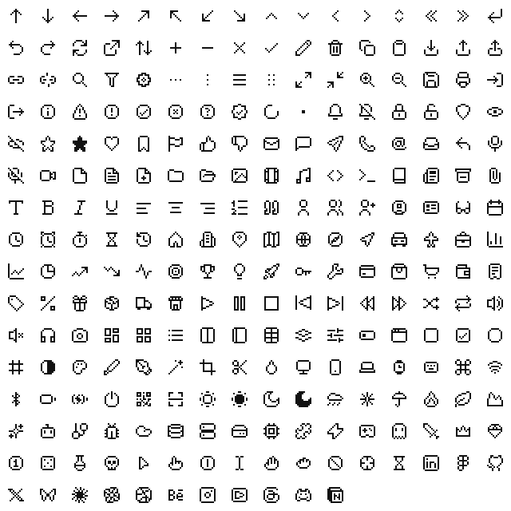

<p align="center">
  
</p>

<h1 align="center">Neume</h1>

<p align="center">
  A pixel icon set that stays crisp at every size, from 12 to 64 px.<br>
  <a href="https://neume.dev">neume.dev</a> ·
  <a href="https://www.npmjs.com/package/@neume-icons/react">npm</a> ·
  <a href="LICENSE">MIT</a>
</p>

<p align="center">
  
</p>

## Why Neume

- **Drawn on a pixel grid, not scaled onto one.** Every icon is drawn cell by cell on a 12 × 12 grid. A
  cell always lands on whole pixels, so edges never blur.
- **One-pixel strokes, centred.** An arrow keeps a stem one cell wide and still sits in the middle of its
  box (see [Centring](#centring)).
- **Any size from 12 to 64, in steps of 4.** The component shows the largest crisp version that fits, and
  centres it. No setting to tune.
- **A second, smaller drawing for dense UIs.** 65 icons also exist on an 8 × 8 grid, used at 16 and 20 px,
  where a shrunken 12 × 12 would be too busy.

## Install

```sh
npm install @neume-icons/react
```

```jsx
import { ArrowUp, Search } from "@neume-icons/react";

<ArrowUp />                              // 24 px, decorative (aria-hidden)
<Search size={16} title="Search" />      // role="img", with an accessible name
<ArrowUp className="text-neutral-500" /> // colour comes from currentColor
```

Each icon is its own module, so your bundle only keeps the icons you import. React 18 or later.

Not using React? `@neume-icons/svg` gives you the SVG of any icon at any size, and ready-made files:

```sh
npm install @neume-icons/svg
```

```js
import { svg } from "@neume-icons/svg";

svg("arrow-up", 32); // '<svg … width="32" height="32" …>'
// or the files: @neume-icons/svg/dist/{12,16,24}/arrow-up.svg
```

## Sizes

| You ask for | You get |
|---|---|
| 12 | the 12 × 12 drawing, 1 px per cell |
| 16, 20 | the 8 × 8 drawing, 2 px per cell (the 12 × 12 at 1 px if there is no 8 × 8) |
| 24, 28, 32 | the 12 × 12 drawing, 2 px per cell |
| 36, 40, 44 | 3 px per cell |
| 48, 52, 56 | 4 px per cell |
| 60, 64 | 5 px per cell |

Any other number is snapped down to the nearest of these (30 → 28, 70 → 64), with a warning in
development.

## Centring

A box of 12, 24 or 48 px has its centre *between* two pixels, so a stem one pixel wide cannot sit exactly
on it. Neume icons with a central stem are drawn half a cell off the grid, and that half-cell is kept when
they are scaled: the stem is exactly centred whenever a cell is an even number of pixels (16, 20, 24, 28,
32, 48, 52, 56), and half a pixel off otherwise — the physical limit.

## The name

Neumes are the signs of plainchant notation. By the 13th century they were written as small square notes:
compact marks on a staff, telling the singer what to do.

## Requests and issues

Missing an icon, or one reads badly at a given size? [Open an issue](https://github.com/florianfaure/neume/issues)
with the name, what it should mean, and where you would use it.

## Development

An npm workspaces monorepo. Icons are drawn in Figma and imported into `icons/*.json`, the source of truth;
everything else is generated from it.

```sh
npm run build   # generate packages/svg and packages/react from icons/*.json
npm run check   # every icon at every size: whole pixels only, generated files up to date
npm run sheet   # a local control sheet, every icon at every size
```

- `packages/svg` — `@neume-icons/svg`: the sizing rule (`src/render.js`, its only copy), the icon data and
  ready-made SVG files.
- `packages/react` — `@neume-icons/react`: one component per icon, built on the core.
- `icons/*.json` is never edited by hand: an icon is fixed in Figma, then synced.

## License

[MIT](LICENSE) © 2026 Florian Faure
